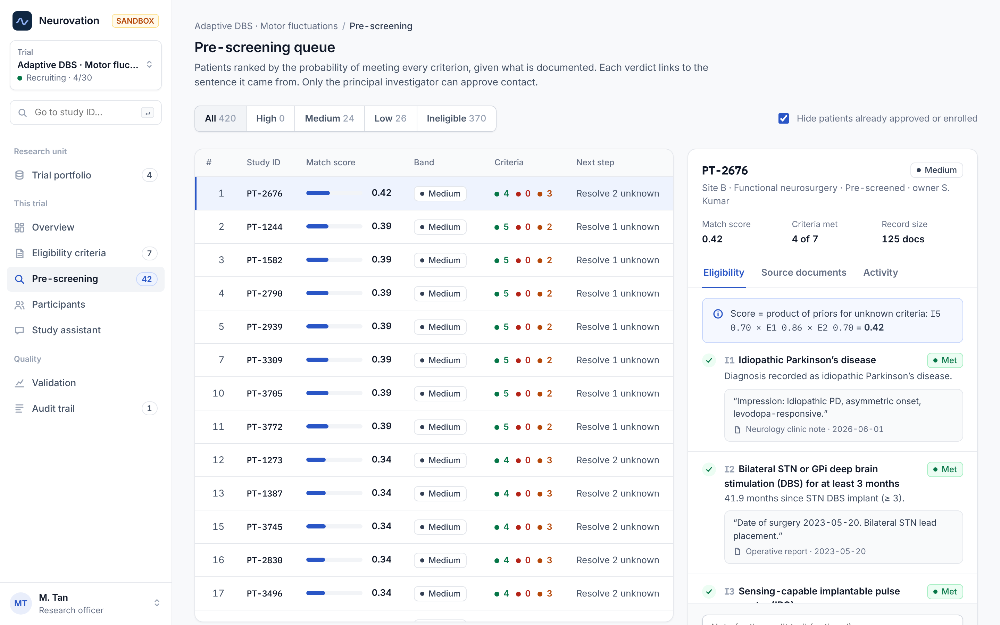

# Neurovation

**A clinician-in-the-loop recruitment platform for Parkinson's disease neuromodulation trials (deep brain stimulation, spinal cord stimulation): motor and non-motor.**
Research prototype for the A\*STAR Innovation Challenge 2026. Synthetic data only. Not for clinical use.



Neurovation turns a trial protocol into a structured eligibility checklist. It screens patient records against that checklist with **three-state verdicts (met / not met / unknown)**, each backed by a quoted source sentence. Patients are ranked by the probability that they meet every criterion. A named clinician approves every contact. The same database drives eConsent tracking, a pseudonymised participant register, a live dashboard and a grounded study assistant.

| Module | What it shows in the prototype |
|---|---|
| **Trial portfolio** | Four Parkinson's disease (PD) trials screened at once: adaptive deep brain stimulation (DBS) for motor fluctuations, early subthalamic DBS for motor complications (modelled on EARLYSTIM), spinal cord stimulation for freezing of gait, and dorsal subthalamic DBS for apathy (the real Zoon et al. 2024 protocol, CC BY 4.0). Each patient's matches across trials, plus an abbreviation glossary. |
| **Eligibility criteria** | Each protocol as editable rules with their source sentences, evidence source and data-freshness windows, plus a draft-criteria extractor for pasted protocol text. |
| **Pre-screening** | 420 synthetic patients ranked by the probability of being eligible. Each criterion shows its evidence quote and the score breaks down into its terms. A *Source documents* tab shows how many documents, across how many systems, a coordinator would have to search by hand. Approve, request information or reject; every action is logged. |
| **Participants & consent** | Electronic consent status, form version control, comprehension check, survey completion, and a role-gated identity vault. |
| **Study assistant** | Staff-facing questions answered only from the protocol and the database, with sources cited and identity questions refused by role. |
| **Validation** | In-silico shadow mode: recall, precision (Wilson 95% confidence intervals), share of charts to read, average precision, criterion-level unknown rates and a coordinator-time model. |
| **Audit trail** | Append-only log of every edit, decision, vault access and assistant query, with CSV export. |

---

## Run it

You need [Node.js 20+](https://nodejs.org) (LTS) and Git.

```bash
git clone https://github.com/<your-org>/neurovation.git
```

```bash
cd neurovation
```

```bash
npm install
```

```bash
npm run dev
```

Open the URL it prints (usually http://localhost:5173). Edits to files in `src/` show up in the browser straight away.

| Command | What it does |
|---|---|
| `npm run dev` | Local development server with hot reload |
| `npm test` | Unit tests for the matching engine, extractor and metrics |
| `npm run build` | Production build into `dist/`, a static website |
| `npm run preview` | Serve the production build locally |

---

## How the team works on this together

The repo is the single source of truth. Each person works on a **branch** and opens a **pull request** (PR). A teammate reviews it, the tests run automatically, and it merges into `main`. Every merge to `main` redeploys the live site.

```
main ──●─────────●─────────●──────▶  (always works, auto-deployed)
        \       /  \       /
feature/ ●──●──●    ●──●──●
dashboard-funnel    matcher-gpi-criteria
```

1. **Once:** one person creates the GitHub repo and adds the others under *Settings → Collaborators*. Turn on *Settings → Pages → Source: GitHub Actions*. Optionally protect `main` under *Settings → Branches* so changes go through a PR.
2. **Each task:** `git checkout -b feature/short-name` → edit → `git commit` → `git push -u origin feature/short-name` → open a PR on GitHub.
3. **Review:** someone else reads the diff and the PR checklist, CI must be green, then *Squash and merge*.
4. **Stay in sync:** `git checkout main && git pull` before starting new work.

If someone is new to Git, **GitHub Desktop** or the Git panel in **VS Code** does all of the above with buttons. Non-coders can edit text and docs directly on github.com (pencil icon → "Create a new branch and start a pull request").

### Suggested ownership (matches the four modules)

| Area | Folder | Owner |
|---|---|---|
| Matching engine, protocols, cohort | `src/engine/`, `src/data/` | _name_ |
| Screening + protocol screens | `src/pages/Screening.tsx`, `Protocol.tsx` | _name_ |
| Consent, participants, vault | `src/pages/Participants.tsx` | _name_ |
| Dashboard + assistant | `src/pages/Dashboard.tsx`, `Assistant.tsx`, `src/engine/assistant.ts` | Thad |
| Validation + slides | `src/pages/Validation.tsx`, `docs/` | _name_ |

Put real GitHub usernames in `.github/CODEOWNERS` so the right person is auto-requested for review.

---

## From a GitHub repo to "software"

A repo is just source code. It becomes software when you **build** it and put the result where users can open it. This project builds to a static website (`dist/`), so you have several options. You can do all of them from the same code:

| Option | Effort | Good for |
|---|---|---|
| **GitHub Pages** (already set up in `.github/workflows/deploy.yml`) | ~0. Push to `main` and get a link like `https://<org>.github.io/neurovation/` | Demo day, sharing with judges and seniors |
| **Vercel / Netlify** | Connect the repo once | Preview link for every PR, so reviewers can click and see the change |
| **Desktop app** with [Tauri](https://tauri.app) or Electron | A day | Running offline on a hospital laptop, a double-clickable `.exe` / `.dmg` |
| **Hospital deployment** (container behind the hospital network, with a backend) | Weeks, after IRB | The real pilot: records never leave the hospital |

For the challenge, **GitHub Pages is enough**. It is free, and the app makes no network calls, so nothing sensitive is ever sent anywhere.

---

## Project structure

```
src/
  data/
    protocols.ts     Four PD trials: 3 motor (adaptive DBS, early DBS, spinal cord stimulation) + apathy (Zoon et al. 2024, real)
    sources.ts       Which hospital system each kind of evidence lives in; record size per patient
    cohort.ts        Seeded synthetic cohort (n = 420): ground truth vs what is documented (missing / stale)
  engine/
    types.ts         Data model
    evaluators.ts    One transparent rule per criterion type → met / not met / unknown + evidence
    matcher.ts       Scoring: P(eligible) = product of priors of unknown criteria; conditional empirical priors
    extract.ts       Protocol text → draft criteria (offline heuristic; LLM in production)
    metrics.ts       Recall/precision sweep, Wilson CI, average precision
    assistant.ts     Grounded intent-based study assistant with role scoping
  state/store.tsx    App state, decisions, audit log
  pages/             One file per screen
  components/        UI primitives and dependency-free SVG charts
tests/               Vitest unit tests
docs/                Architecture, data notes, slide guide
```

See [`docs/ARCHITECTURE.md`](docs/ARCHITECTURE.md) for the production design (where the LLM goes and how it is constrained), [`docs/DATA.md`](docs/DATA.md) for how the synthetic cohort is generated, and [`docs/SLIDE_GUIDE.md`](docs/SLIDE_GUIDE.md) for the presentation guide.

## Design system

The look follows the conventions of enterprise clinical-trial software (CTMS, EDC and site-recruitment platforms): quiet light chrome, dense bordered tables, a split-pane patient record, small bordered status badges, and one sober blue for actions. Nothing should look like marketing.

| Token | Hex | Use |
|---|---|---|
| Text 1 / 3 / 5 | `#101828` / `#475467` / `#98A2B3` | Headings / body / hints (cool grey scale) |
| Border | `#E4E7EC` | Panel and table lines; panels are separated by borders, not heavy shadows |
| Canvas | `#F8F9FB` | Page background (panels are white) |
| Primary | `#2A56C6` | The only action colour: primary buttons, score bars, selected rows, active tab |
| Brand ink | `#0F2742` | Logo mark and assistant avatar |
| Met | `#067647` on `#ECFDF3` | Criterion met, enrolled, complete |
| Not met | `#B42318` on `#FEF3F2` | Criterion not met, overdue |
| Unknown | `#B54708` on `#FFFAEB` | Missing or stale evidence, needs action |

Status is never shown by colour alone: every badge also carries a word. Type is Inter (14 px body, 13.5 px tables, tabular numerals), with IBM Plex Mono for study IDs and formulas.

## Data and licence notes

* **No real patient data** is in this repo, now or ever. The cohort is generated by a seeded random process (`src/data/cohort.ts`).
* The dSTN-DBS protocol text is from Zoon et al., *Trials* 2024;25:104, CC BY 4.0. Sentences marked "paraphrased" should be checked against the full text.
* The adaptive-DBS protocol was written for this demo and is not a real trial.
